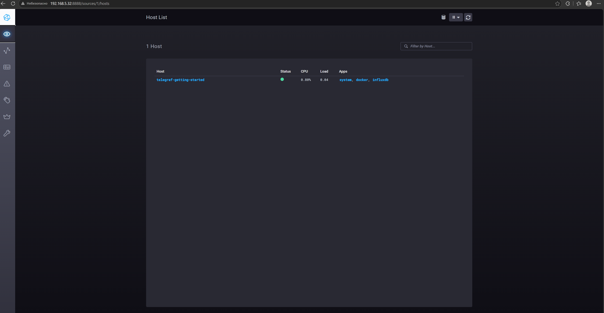
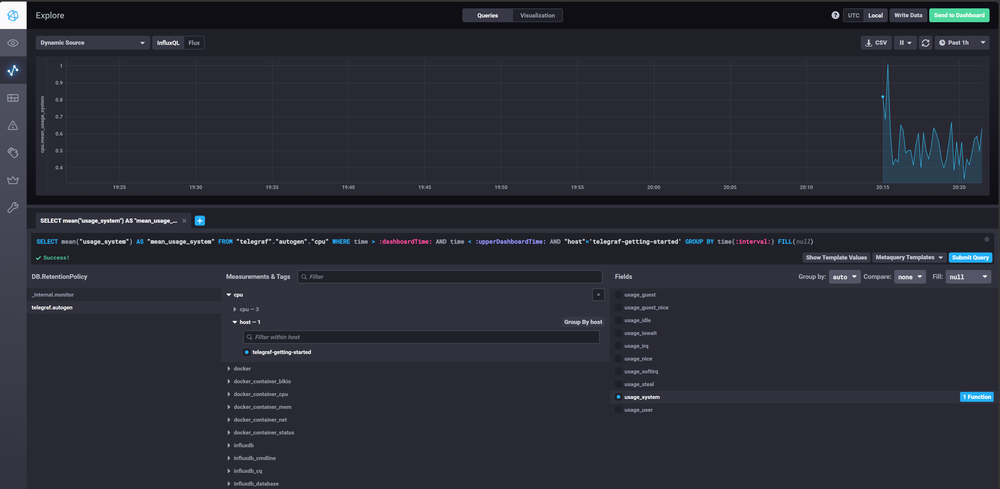
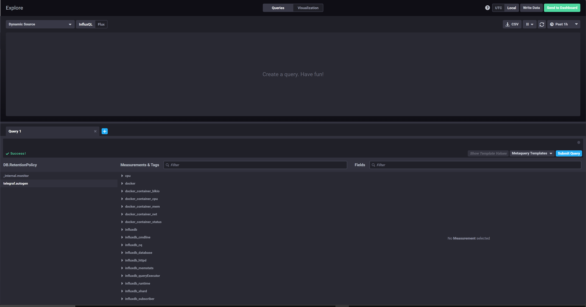

# Системы мониторинга

## Задание 1

Минимальный набор метрик:

- CPU (загрузка и load average), потому что вычисления грузят процессор и это главное, что надо отслеживать.
- RAM и swap, чтобы понимать, не упираемся ли в память и не начинает ли система уходить в swap.
- Свободное место на диске и inodes, потому что отчёты пишутся на диск, и если он забьётся, платформа встанет. Inodes тоже, файлов может быть много.
- Нагрузка на диск (iops, latency), так как мы постоянно пишем отчёты.
- Сеть (трафик, ошибки), раз общение идёт по http.
- По http: количество запросов, коды ответов (2xx, 4xx, 5xx) и время ответа. Это показывает, как сервис работает для клиентов.

## Задание 2

Менеджеру RAM, inodes и CPU LA не нужны, ему надо показывать качество сервиса. Предложил бы SLI/SLO/SLA:

- SLI — что меряем: процент успешных запросов, время ответа, доля нормально завершённых вычислений.
- SLO — цель, например 99% успешных запросов и ответ быстрее секунды в 95% случаев.
- SLA — что обещаем клиентам.

И сделать для него простой дашборд: доступность за месяц, среднее время получения отчёта, сколько было инцидентов.

## Задание 3

Если денег на систему сбора логов нет, можно поставить Sentry (бесплатный тариф или self-hosted). В приложение подключается SDK, и все ошибки с стектрейсом приходят разработчикам сразу, без сбора всех логов.

## Задание 4

Ошибка в формуле. Она не учитывает коды 3xx (редиректы). Это тоже успешные ответы, но они не 2xx, поэтому попадают только в знаменатель. Раз 4xx и 5xx нет, то оставшиеся 30% это 3xx. Правильно считать так:

```
(summ_2xx + summ_3xx) / summ_all_requests
```

## Задание 5

Pull (система сама ходит за метриками):

- плюсы: сервер сам решает, кого и как часто опрашивать; сразу видно, что узел упал (опрос не прошёл); можно руками открыть адрес с метриками и проверить.
- минусы: серверу нужен доступ до всех узлов (проблемы с NAT и файрволом); плохо работает с короткими задачами, они могут закончиться до опроса.

Push (узлы сами отправляют метрики):

- плюсы: работает через NAT и файрвол; подходит для коротких задач и событий.
- минусы: непонятно, молчит узел потому что сломался или потому что нечего слать; узлы должны знать адрес сервера; при большом потоке можно перегрузить сервер.

## Задание 6

- Prometheus — pull. Через Pushgateway умеет и push для коротких задач.
- TICK — push, telegraf сам отправляет метрики в InfluxDB.
- Zabbix — гибридный: есть пассивные проверки (pull) и активный агент (push).
- VictoriaMetrics — гибридная: может сама скрейпить как Prometheus, и принимает данные push-ом.
- Nagios — в основном pull (сервер сам запускает проверки), но есть и пассивные проверки, когда результат присылают ему.

## Задание 7

Склонировал репозиторий influxdata/sandbox и запустил TICK-стек через docker compose. Скриншот Chronograf:



## Задание 8

В Data Explorer выбрал базу telegraf.autogen, measurement cpu, host telegraf-getting-started, поле usage_system. Скриншот графика:



## Задание 9

Добавил в telegraf.conf плагин docker:

```
[[inputs.docker]]
  endpoint = "unix:///var/run/docker.sock"
```

В docker-compose.yml для telegraf добавил `privileged: true`, `user: root` и `entrypoint: ["telegraf"]`, иначе у него не было доступа к docker.sock. После перезапуска в telegraf.autogen появились docker-метрики:


